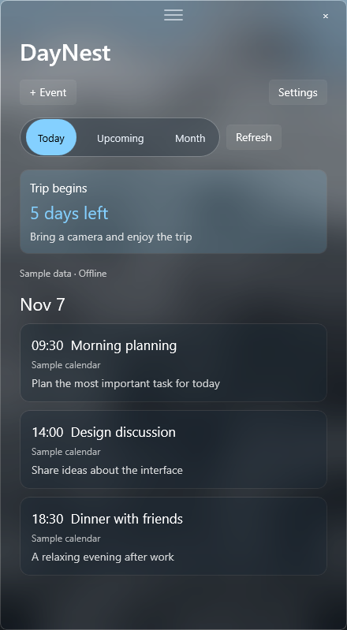
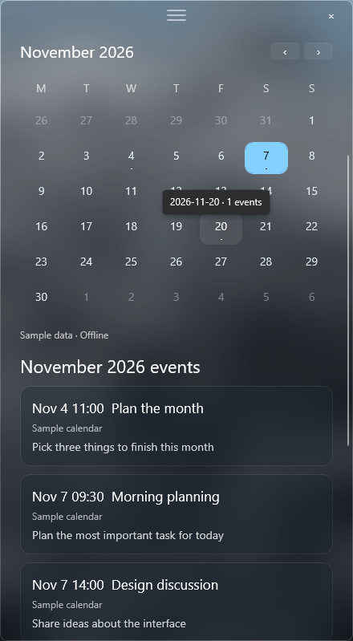

[简体中文](../../README.md) | [English](README.en.md) | [日本語](README.ja.md)

# DayNest · Your calendar on the desktop

Keep your schedule on the desktop and important dates in sight.

DayNest is a desktop calendar widget for Windows 11 x64, available in Simplified Chinese, English, and Japanese. Its interface is built with C# and WinUI 3. A Python backend handles CalDAV sync, event parsing, and encrypted caching. The older Tk interface and its installer build are retired; existing accounts and caches remain compatible.

## Preview

These screenshots show the English interface with offline sample data, not a personal calendar. Click an image to view it at full size.

| Today and countdown | Month and calendar |
| :---: | :---: |
|  |  |

## Download and get started

Download the [v2.1.0 portable release](https://github.com/LeoStr4nge/DayNest/releases/tag/v2.1.0), extract the entire ZIP file, and run `DayNest.Glass.exe`. Python and .NET runtimes are included. DayNest requires Windows 11 x64 (build 22000 or later). There is currently no installer for the WinUI version.

The release is not code signed. You can verify the download with `SHA256SUMS.txt` from the release page. Previous release tags and archives remain available.

On first launch, open **Settings → Calendar account**, select a calendar provider, enter your credentials, and choose **Save and sync**. For iCloud, generate an [app-specific password for your Apple Account](https://account.apple.com/).

## Using DayNest

- **Today / Upcoming / Month**: view today's events, the next eight days (today plus seven), or expand the month calendar and choose a date.
- **+ Event**: choose a target calendar and enter a title, start and end times, and notes using the date and time pickers.
- Select an event to see its full details. You can edit a single non-all-day event. Deletion requires confirmation. Editing or deleting recurring events is not supported; all-day events can be deleted.
- Pin an event countdown from its details. Select the pinned card to see its details, or right-click to unpin it.
- **Settings → Appearance & personalization**: choose the interface language, one of six themes, a custom color, glass effect and intensity, desktop widget mode, automatic removal of expired countdowns, and launch at Windows sign-in. Choose **Save appearance** to keep your changes. A language change takes effect after restarting DayNest.
- In desktop widget mode, drag the three lines at the top to move the widget. It stays visible after Win+D. Use the × in the upper-right corner to exit.

DayNest shows its encrypted cache first and then syncs. It syncs automatically every ten minutes. Today and Upcoming load only the months they need; adjacent months are prefetched only when the calendar is open. You can use **Refresh** to sync immediately. Pinned events track changes and deletions made on other devices; if the network fails, the last known data stays visible.

Only one instance runs per Windows sign-in session. Starting DayNest again brings the existing window forward. If you close the window during an event save, DayNest waits for the write to finish.

## Calendar services

**iCloud:** Choose **iCloud** under Calendar service, then enter your account and app-specific password. No manual URL is required. Existing iCloud settings are recognized automatically.

**Custom CalDAV:** Choose **Custom CalDAV**, then enter the HTTPS address and credentials supplied by your provider.

| Field | Purpose |
| --- | --- |
| Discovery URL | Required. For example, `https://calendar.example/.well-known/caldav`, a provider's user URL, or a calendar home URL. |
| Calendar home (optional) | If known, enter it to skip account discovery. |
| Trusted origins (optional) | Add other HTTPS origins only if your provider uses multiple domains, such as `https://storage.example:8443`. Separate multiple origins with commas; omit paths. |

DayNest discovers calendars from the service response and follows HTTPS redirects within trusted origins. Add any other provider domain to Trusted origins before DayNest can send credentials to it. Changing the account or connection requires the password again and a new sync; local pins and caches from the old service are cleared. One service account can be connected at a time.

DayNest currently supports username/password authentication over HTTPS. It does not support OAuth, plain HTTP, or ICS subscription URLs. **The iCloud preset and custom CalDAV connections have been checked with offline simulated protocol tests, but have not yet been retested against live servers.** Compatibility of discovery, sync, and writes with real servers still needs verification.

## FAQ

**Can't find the widget?**

Run `DayNest.Glass.exe --normal-window` from the extracted folder to bring an existing instance into a regular window. The development build supports this option too.

**Want to run from source?**

See the [development guide](../development.md) and [WinUI build and feature notes](../../prototypes/DayNest.Glass/README.md). Run the compiled `DayNest.Glass.exe`; `daynest.py` is a backend module, not a graphical launcher.

**Where is local data stored?**

Account and calendar data live in `%APPDATA%\DayNest`; passwords and caches use Windows DPAPI encryption. Appearance and window position live in `%LOCALAPPDATA%\DayNest`. Do not share these files publicly. Unknown fields in older settings are preserved, though the retired Tk interface no longer reads them.

**How do I uninstall DayNest?**

Close DayNest and delete the portable folder. If launch at sign-in is enabled, turn it off in Appearance settings and save first. Personal settings and calendar caches remain on your computer by default.

## License

DayNest is licensed under [GNU GPLv3](../../LICENSE) (`GPL-3.0-only`). Third-party components retain their own licenses; the release includes the relevant license texts.
