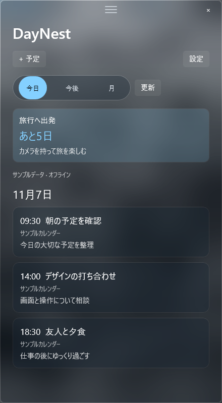
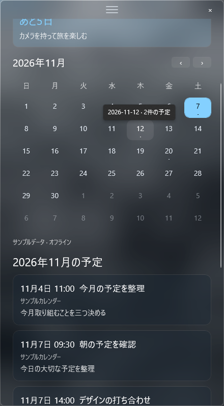

[简体中文](../../README.md) | [English](README.en.md) | [日本語](README.ja.md)

# DayNest · デスクトップで使えるカレンダー

予定をデスクトップに。大切な日を、いつでも目に入る場所に。

DayNest は Windows 11 x64 向けのデスクトップカレンダーウィジェットです。画面表示は簡体字中国語、英語、日本語に対応しています。画面には C# / WinUI 3 を使用し、CalDAV 同期、予定の解析、暗号化キャッシュは Python 側で処理します。旧 Tk 版の画面とインストーラーは廃止しましたが、既存のアカウント設定とキャッシュは引き続き利用できます。

## 画面イメージ

以下は日本語表示で、オフラインのサンプルデータを使った画面です。個人の予定は含まれていません。画像をクリックすると原寸で表示できます。

| 今日の予定とカウントダウン | 月表示とカレンダー |
| :---: | :---: |
|  |  |

## ダウンロードと初期設定

[v2.1.0 のポータブル版](https://github.com/LeoStr4nge/DayNest/releases/tag/v2.1.0)をダウンロードし、ZIP ファイルをすべて展開してから `DayNest.Glass.exe` を起動してください。Python と .NET の実行環境は同梱されています。Windows 11 x64（ビルド 22000 以降）が必要です。現時点では WinUI 版のインストーラーはありません。

公開中の実行ファイルにはコード署名がありません。ダウンロードしたファイルは、リリースページの `SHA256SUMS.txt` で検証できます。過去のリリースタグとアーカイブも引き続き公開しています。

初回起動時は **設定 → カレンダーアカウント** でサービスを選び、アカウント情報を入力して **保存して同期** を押してください。iCloud を利用する場合は、[Apple Account](https://account.apple.com/)でアプリ用パスワードを発行してください。

## 使い方

- **今日 / 今後 / 月**：今日の予定、今日から 8 日間の予定、または月間カレンダーを表示します。月間カレンダーから日付を選べます。
- **+ 予定**：保存先のカレンダーを選び、タイトル、開始・終了日時、メモを入力します。日時は画面上の選択欄から指定できます。
- 予定をクリックすると詳細を確認できます。単発の予定は終日予定を除き編集できます。削除前には確認画面が表示されます。繰り返し予定の編集・削除は未対応です。終日予定は削除できます。
- 詳細画面から予定をデスクトップに固定すると、カウントダウンを表示できます。固定したカードをクリックすると詳細を確認でき、右クリックで固定を解除できます。
- **設定 → 外観とカスタマイズ**：表示言語、6 種類のテーマ、カスタムカラー、ガラス効果と濃度、デスクトップウィジェットモード、期限切れカウントダウンの自動解除、Windows サインイン時の自動起動を設定できます。変更を残すには **外観を保存** を押してください。言語の変更は再起動後に反映されます。
- デスクトップウィジェットモードでは、上部の三本線をドラッグして移動できます。Win+D の後も表示されます。終了するには右上の × を押してください。

起動時は暗号化されたキャッシュを先に表示し、その後カレンダーを同期します。自動同期は 10 分ごとです。「今日」と「今後」の表示では必要な月だけを読み込み、月間カレンダーを開いたときに限り前後の月を先読みします。**更新** を押すとすぐに同期できます。固定した予定は他の端末での日時変更や削除にも追従し、通信に失敗した場合は前回のデータを表示し続けます。

同じ Windows サインインセッションでは一つの DayNest だけが起動します。再度起動すると既存の画面が呼び出されます。予定の保存中に画面を閉じた場合は、書き込みが完了してから終了します。

## カレンダーサービスへの接続

**iCloud：** 「カレンダーサービス」で **iCloud** を選び、アカウントとアプリ用パスワードを入力してください。URL の手入力は不要です。以前の iCloud 設定も自動的に認識します。

**カスタム CalDAV：** **カスタム CalDAV** を選び、サービス提供元から案内された HTTPS アドレスと認証情報を入力してください。

| 項目 | 説明 |
| --- | --- |
| 検出 URL | 必須。例：`https://calendar.example/.well-known/caldav`、サービスが提供するユーザー URL、またはカレンダーのホーム URL。 |
| カレンダーのホーム URL（任意） | 分かっている場合に入力すると、アカウントの検出を省略できます。 |
| 信頼する接続先（任意） | サービスが複数のドメインを使う場合だけ、`https://storage.example:8443` のように HTTPS の接続先を指定します。複数ある場合はカンマで区切り、パスは含めないでください。 |

DayNest はサービスの応答からカレンダーを検出し、信頼する接続先の範囲内で HTTPS リダイレクトに対応します。別のドメインへ認証情報を送る必要がある場合は、先にそのドメインを信頼する接続先へ追加してください。アカウントや接続設定を変更するときはパスワードの再入力と再同期が必要です。変更前のサービスに属するローカルの固定項目やキャッシュは削除されます。同時に接続できるサービスアカウントは一つです。

現在対応している認証方法は HTTPS 上のユーザー名とパスワードです。OAuth、暗号化されない HTTP、ICS の購読 URL には対応していません。**iCloud のプリセットとカスタム CalDAV 接続は、オフラインの模擬テストで確認していますが、実際のサーバーではまだ再検証していません。** 実サーバーでの検出、同期、書き込みの互換性は今後確認が必要です。

## よくある質問

**ウィジェットが見つからない場合は？**

展開先のフォルダーで `DayNest.Glass.exe --normal-window` を実行すると、起動中の DayNest を通常のウィンドウとして表示できます。開発版でも同じオプションを使用できます。

**ソースコードから起動するには？**

[開発ガイド](../development.md)と [WinUI のビルド・機能説明](../../prototypes/DayNest.Glass/README.md)をご覧ください。ビルド後の `DayNest.Glass.exe` を起動します。`daynest.py` はバックエンド用のモジュールで、画面を起動するファイルではありません。

**ローカルデータの保存先は？**

アカウントと予定のデータは `%APPDATA%\DayNest` に保存され、パスワードとキャッシュは Windows の DPAPI で暗号化されます。外観とウィンドウ位置は `%LOCALAPPDATA%\DayNest` に保存されます。これらのファイルを公開しないでください。旧設定の未知の項目は保持されますが、廃止した Tk 版の画面では使われません。

**アンインストールするには？**

DayNest を終了し、ポータブル版のフォルダーを削除してください。自動起動を有効にしている場合は、先に外観設定で無効にして保存します。個人設定と予定のキャッシュは初期状態ではそのまま残ります。

## ライセンス

DayNest は [GNU GPLv3](../../LICENSE)（`GPL-3.0-only`）で公開しています。サードパーティー製コンポーネントにはそれぞれのライセンスが適用され、関連するライセンス文書は配布パッケージに同梱しています。
